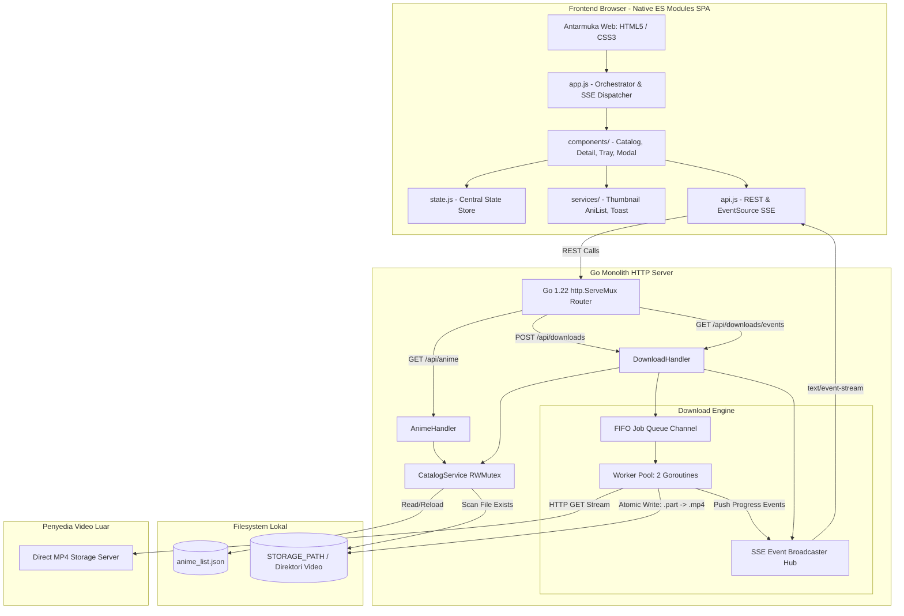

# Arsitektur Sistem: Anime Batch Downloader

Dokumen ini menjelaskan arsitektur teknis, desain komponen, dan keputusan rekayasa di balik aplikasi **Anime Batch Downloader**.

---

## 1. Diagram Arsitektur Komponen

---

## 2. Tanggung Jawab Komponen

### 2.1 `internal/catalog` (Catalog Service)
- Membaca berkas `anime_list.json` dan memetakannya ke struktur Go secara aman (*thread-safe* menggunakan `sync.RWMutex`).
- Bertanggung jawab memindai direktori disk lokal (`os.Stat`) untuk mendeteksi apakah suatu file video sudah ada atau belum (`isDownloaded: true/false`).
- Menstandardisasi struktur folder dan penamaan file:
  - Folder: `<Base Storage>/<Anime Title>/Season <N>/`
  - Nama File: `<Anime Title> - S<0N>E<0N>.mp4`
- Mendukung fitur *Reload* tanpa perlu restart server.

### 2.2 `internal/downloader` (Download Engine)
Download Engine dirancang untuk keandalan jaringan lokal dan pencegahan ban dari CDN penyedia:
- **`WorkerPool`**:
  - Mengelola kapasitas worker tetap (**2 unduhan aktif serentak**).
  - Menggunakan channel buffer Go sebagai FIFO Job Queue berkapasitas 500 item.
  - Memetakan fungsi pembatalan per-job menggunakan `context.CancelFunc`.
- **`Worker` (Streaming & Atomic File Writing)**:
  - Melakukan HTTP streaming dengan buffer 64KB.
  - Menghitung kecepatan rata-rata (*transfer speed*) dan persentase progress setiap 500ms.
  - **Integritas File**: File ditulis ke file sementara `<Filename>.mp4.part`. Hanya setelah stream HTTP tuntas 100% dengan EOF, file di-rename atomik ke ekstensi `.mp4`.
  - Jika terjadi pembatalan (*cancel*) atau putus jaringan, file `.part` langsung dihapus agar tidak menyisakan file korup di disk.
- **`SSEHub`**:
  - Mendistribusikan event real-time (`progress`, `completed`, `failed`, `canceled`, `enqueued`) ke seluruh browser client yang terhubung via `text/event-stream`.

### 2.3 `internal/handler` (HTTP Layer)
- Menerjemahkan request HTTP ke pemanggilan service dan menghasilkan response JSON yang konsisten.
- Endpoint SSE menggunakan `http.Flusher` untuk memastikan setiap event terkirim seketika tanpa tertahan buffer web server.

### 2.4 `web/` (Frontend Layer)
- Dibangun dengan **Vanilla HTML, CSS, dan JavaScript Native ES Modules (ESM)** tanpa dependensi `node_modules` atau bundler (Webpack/Vite).
- Arsitektur berbasis modul terisolasi:
  - **`app.js` (Orchestrator)**: Titik masuk aplikasi, inisialisasi modul komponen, setup listener SSE real-time, dan navigasi view.
  - **`state.js`**: Reaktif in-memory central state store (`animeList`, `currentAnime`, `activeJobs`).
  - **`api.js`**: Klien fetch REST dan pembungkus EventSource Server-Sent Events.
  - **`services/`**: Layanan terisolasi seperti `thumbnail.js` (AniList GraphQL API + localStorage cache) dan `toast.js` (notifikasi UI).
  - **`components/`**: Komponen modular independen (`catalog-view.js`, `detail-view.js`, `download-tray.js`, `import-modal.js`).
  - **`utils.js`**: Fungsi pembantu murni (`escapeHtml`, `formatBytes`).
- Memiliki laci status mengambang (*Download Tray*) yang memantau progres unduhan secara real-time via SSE.

---

## 3. Kebijakan & Trade-off Desain

| Keputusan | Alasan / Justifikasi | Trade-off |
| :--- | :--- | :--- |
| **Go Standard Library** | Menghindari *dependency bloat*, performa sangat tinggi, dan memudahkan *maintenance* jangka panjang. | Sedikit lebih manual dalam penanganan routing (diselesaikan dengan fitur Go 1.22 mux). |
| **Worker Concurrency = 2** | Menghindari saturasi bandwidth rumah tangga dan mencegah pemblokiran IP oleh server penyedia video. | Kecepatan unduh batch bergantung pada antrean sequential, bukan unduhan massal serentak. |
| **In-Memory Queue (MVP)** | Sangat cepat diimplementasikan dan ringan tanpa perlu setup database SQLite/PostgreSQL. | Jika server dimatikan paksa, antrean aktif hilang; namun file yang sudah tuntas tetap aman di disk. |
| **Penyimpanan Lokal Disk Langsung** | Mengeliminasi dialog save browser berulang kali dan memungkinkan folder terorganisir otomatis. | Server harus berjalan di mesin yang sama dengan filesystem tujuan. |
